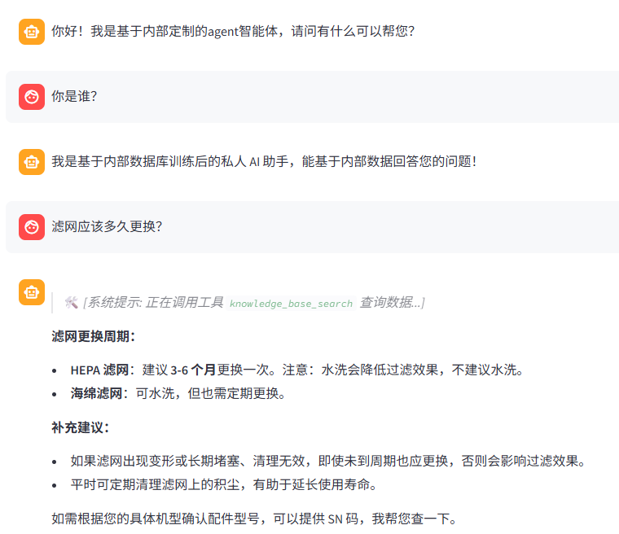
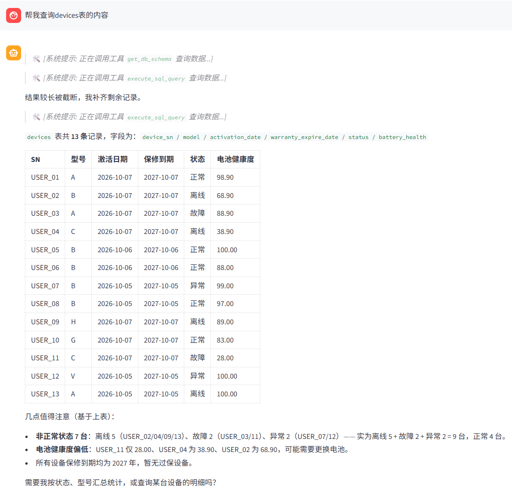
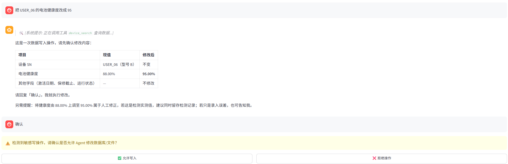
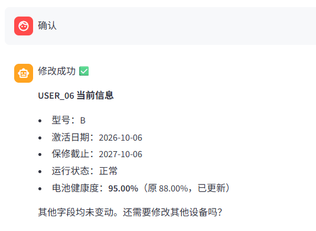
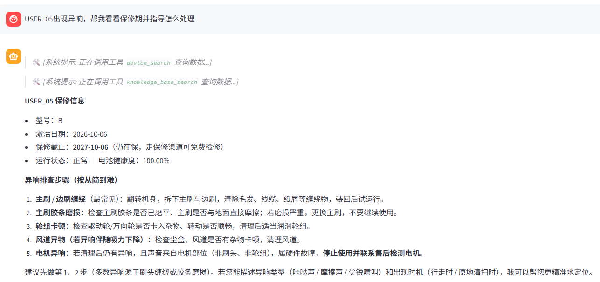
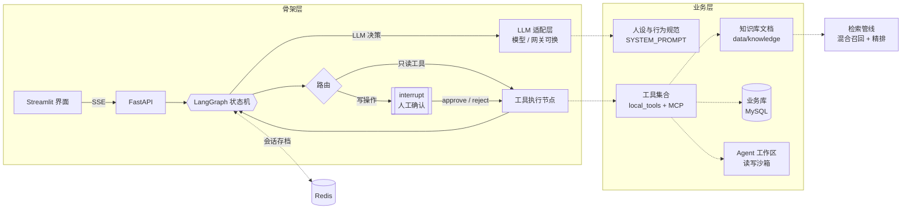

# 可定制化 企业级Agent

一套**骨架与业务分离**的 Agent 工程实现：这个项目可以把「企业落地一个 Agent」里 90% 与行业无关的部分做成可复用骨架，业务侧只提供四样东西——**知识、数据、工具、人设**。

仓库自带一个完整跑通的实例（扫地机器人售后运维），用来证明这套骨架能同时覆盖「知识库问答 / 结构化查询 / 写操作确认 / 文件读写」四类工具形态(后续需要可再添加)。

> 换行业不需要改动状态机、调度、流式、会话存档和检索管线；需要动的只有配置、SQL、工具清单和一段系统提示词。

---

## 为什么是「可定制化」

我个人认为企业做 Agent，卡住的从来不是「把模型调通」，而是这四件事：

| 问题 | 通用解法 | 是否与业务相关 |
|---|---|---|
| **幻觉**：模型编造型号、字段、保修期 | RAG 检索兜底 + 强制「只依据事实」的行为规范 | 否，骨架层 |
| **权限**：模型被诱导读写不该碰的路径/表 | 工具沙箱 + SQL AST 白名单 | 否，骨架层 |
| **可控**：写库、写文件不可逆 | 图状态机在敏感节点前 `interrupt`，等人确认 | 否，骨架层 |
| **可观测**：长任务无反馈、重启丢上下文 | SSE 流式 + Redis checkpointer | 否，骨架层 |

既然解法与行业无关，就该沉到骨架里；真正随业务变化的只有 **知识、数据、工具、人设** —— 本仓库的目录结构与配置边界，就是按这条线切的：

| 层 | 内容 | 换业务时 | 位置 |
|---|---|---|---|
| 骨架层 | 状态机、工具调度、人工确认、会话存档、流式输出、检索管线 | **不改** | `Agent/` `Port/` `RAG/` `Frontend/` |
| 业务层 | 知识库、业务表、工具集合、人设与行为规范 | **只换这一层** | `Common/config/` `data/` `deploy/` |

---

## 效果演示

> 演示环境：本地 Ollama 向量检索 + MySQL 设备库；设备数据为演示用测试数据，非生产数据。

**① 知识库问答** —— 先调 `knowledge_base_search`，答案来自内部知识库而不是模型臆测。



**② 结构化查询** —— `get_db_schema` → `execute_sql_query`；结果超长被截断后自动补查，末尾主动追问是否要按型号汇总。



**③ 敏感操作人工确认** —— 写库前由图状态机中断，前端弹出「允许 / 拒绝」，点「允许」才真正执行；靠的是 `interrupt_before`，不是提示词约束。



确认后回执，并给出变更前后值便于核对：



**④ 多跳规划** —— 一个问题里先查保修（`device_search`）再查排查步骤（`knowledge_base_search`），最后合并成一份带优先级的处置建议。



---

## 定制清单

| 想改什么 | 改哪里 | 备注 |
|---|---|---|
| 对话模型 / 网关 | `.env` → `CHAT_MODEL_NAME`、`DEEPSEEK_BASE_URL` | 任何 OpenAI 兼容网关都能接；不填 base_url 走内置默认 |
| 向量模型 | `.env` → `EMBEDDING_MODEL_NAME`、`OLLAMA_BASE_URL` | 本地 Ollama，模型可任意替换 |
| 精排模型 | `.env` → `RERANKER_PATH / RERANKER_ENABLED / RERANKER_DEVICE` | 没装权重或没装 torch 时**自动降级**为不精排 |
| 知识库内容 | `data/knowledge/` + `python -m scripts.seed_demo --ingest` | 支持 txt / pdf、md，文件级 + 切片级双重去重 |
| 业务库连接 | `Common/config/agent.yml`（全部走 `${ENV}` 占位符） | 口令只从环境变量读 |
| 业务表结构 | `deploy/init.sql` + 工具内的 SQL 语句 | 换成你的订单/工单/设备表 |
| 新增工具 | `Agent/agent.py` 的 `local_tools`（进程内）<br/>或 `Agent/mcp_tools/`（MCP 子进程，独立进程、独立依赖） | 两种接入方式并存，同名工具自动去重 |
| 人设与行为规范 | `Agent/agent.py` 的 `SYSTEM_PROMPT`（单点定义） | 换行业时这段文字改掉即可 |
| 敏感操作清单 | `should_continue()` 里的工具名列表 + `interrupt_before` | 决定哪些工具执行前必须等人点头 |
| 部署形态 | 本地进程 / `docker compose` | 模型权重走 volume 挂载，不进镜像 |

---

## 内置实例：扫地机器人售后运维

选这个实例不是因为「只能做售后」，而是它**恰好覆盖四类工具形态**，任何行业都能映射上来：

| 工具形态 | 实例实现 | 换成你的业务 |
|---|---|---|
| 非结构化检索 | `knowledge_base_search`（Chroma + BM25 + CrossEncoder） | 产品手册、合同、SOP、工单历史 |
| 结构化只读查询 | `device_search`、`execute_sql_query`、`get_db_schema` | 订单、工单、库存、CRM |
| 结构化写入（需确认） | `add_device`、`update_device` | 派单、退款、改状态 |
| 文件读写（沙箱） | `read_file`（MCP 子进程）、`write_file` | 导出报表、落地巡检记录 |

对应的业务库种子数据在 `deploy/init.sql`，演示知识库由 `scripts/seed_demo.py` 生成。

---

## 定制之后怎么验证

可定制化的前提是**改完能立刻知道对不对**，所以仓库提供三段式自检：

```bash
python -m scripts.preflight    # 依赖 / 环境变量 / MySQL / Redis / Ollama / 模型路径 一键体检
python -m scripts.seed_demo    # 造一套新的演示知识库与工作区文件（--ingest 可写入向量库）
python -m pytest tests -s -q   # MCP 工具链路联通性
```

`preflight` 会逐项打印 ✅ / ⚠️ / ❌ 并在有 ❌ 时返回非零退出码，可直接挂到 CI。

---

## 架构



**请求链路**：`前端 → FastAPI(SSE) → LangGraph →（LLM 决策 → 工具调用 → 回到 LLM）→ 流式返回`。
敏感操作在 `sensitive_tools` 节点前中断，前端弹出确认，用户 approve 后才真正执行 —— 这条路径与业务无关，换行业后依然生效。

---

## 骨架内置能力

| 能力 | 解决的问题 | 代码位置 |
|---|---|---|
| **混合检索 + 精排** | 纯向量检索对型号、错误码这类关键词不敏感 | `RAG/RAG.py` `_init_retriever` / `rerank` |
| **两级 MD5 去重** | 重复上传同一文档导致向量库膨胀 | `RAG/RAG.py` `upload`（文件级 + 切片级） |
| **Human-in-the-loop** | 写库/写文件这类不可逆操作不能只靠提示词约束 | `Agent/agent.py` `interrupt_before=["sensitive_tools"]` |
| **SQL AST 白名单** | 正则拦 `DROP` 会被注释、大小写、子查询绕过 | `Agent/agent.py` `execute_sql_query`（`sqlglot` 解析后判节点类型） |
| **工具沙箱** | 模型可能被诱导读写工作区外的文件 | `Agent/mcp_tools/file_mcp_server.py` `_resolve_safe_path` |
| **工具死循环熔断** | 模型反复用同样参数调同一个工具 | `Agent/agent.py` `Node_tool`（对 tool_call 做 MD5 去重） |
| **会话持久化** | 服务重启后多轮上下文丢失 | `AsyncRedisSaver` + `thread_id` 隔离 |
| **流式 + 可取消** | 长任务无反馈、无法中断 | `Port/server.py` `astream_events` + `ACTIVE_TASKS` |
| **降级运行** | 缺模型权重 / 缺 Redis 模块 / 缺 MCP 适配器时整站起不来 | Reranker 缺失跳过精排、向量服务失败回退 BM25、`MCP_ENABLED=0` 关闭 MCP |
| **配置环境变量化** | 路径、口令、模型名写死，别人 clone 跑不起来 | `Common/utils/config_handler.py` |

---

## 快速开始

### 方式 A：Docker Compose（一次拉起 MySQL + Redis + API + 前端）

```bash
cp .env.example .env          # 填入 DEEPSEEK_API_KEY 等
docker compose up -d --build
# API   http://127.0.0.1:8000/docs
# 前端   http://127.0.0.1:8501
```

本地模型**不打进镜像**，二选一：

```bash
# 1) 复用宿主机已装好的 Ollama
ollama serve && ollama pull qwen3-embedding:4b

# 2) 用容器内 Ollama（首次会下载约 2.5GB）
docker compose --profile ollama up -d
docker compose exec ollama ollama pull qwen3-embedding:4b
```

精排权重不进仓库，用脚本拉到 `./models/bge-reranker-v2-m3`（约 2.2GB，volume 只读挂载）：

```bash
pip install huggingface_hub
python -m scripts.fetch_reranker                                     # 或
HF_ENDPOINT=https://hf-mirror.com python -m scripts.fetch_reranker   # 国内镜像
```

### 方式 B1：Windows 原生（PyCharm / PowerShell）

```powershell
# 1) 虚拟环境（Python 3.12+，开发环境验证于 3.14.4）
python -m venv .venv
.\.venv\Scripts\Activate.ps1     # 若提示执行策略，先 Set-ExecutionPolicy -Scope CurrentUser RemoteSigned

# 2) 依赖
pip install -r requirements.txt -r requirements-local.txt

# 3) 配置：只需改 MySQL / Redis 地址，Ollama 在本机就保持 127.0.0.1
copy .env.example .env

# 4) 自检 + 演示数据
python -m scripts.preflight
python -m scripts.seed_demo
python -m scripts.seed_demo --ingest      # 需要 Ollama 已启动

# 5) 启动（两个终端）
python -m Port.server                     # 后端 http://127.0.0.1:8000/docs
streamlit run Frontend\ui_cli.py          # 前端 http://127.0.0.1:8501
```

**PyTorch 怎么选：**

| 场景 | 安装方式 | `.env` |
|---|---|---|
| 无 NVIDIA 显卡 / 精排只想跑 CPU | `pip install torch==2.14.0 --index-url https://download.pytorch.org/whl/cpu` | `RERANKER_DEVICE=cpu` |
| 有 NVIDIA 显卡（RTX 50 系为 sm_120，需 CUDA 12.8+ 构建） | `pip install torch==2.14.0 --index-url https://download.pytorch.org/whl/cu128` | `RERANKER_DEVICE=cuda` |

### 方式 B2：Linux / macOS 本地进程

```bash
python -m venv .venv && source .venv/bin/activate
pip install torch==2.14.0 --index-url https://download.pytorch.org/whl/cpu
pip install -r requirements.txt -r requirements-local.txt

cp .env.example .env
python -m scripts.preflight
python -m scripts.fetch_reranker      # 可选
python -m scripts.seed_demo
python -m scripts.seed_demo --ingest

python -m Port.server
streamlit run Frontend/ui_cli.py
```

### 方式 C：只想快速验证

```bash
MCP_ENABLED=1 RERANKER_ENABLED=false python -m scripts.preflight
python -m pytest tests -s -q          # 只验证 MCP 文件工具链路
```

> 核心对话链路依赖 Redis（checkpointer）与 LLM API，这是设计上的硬依赖；
> 检索链路做了降级：向量服务不可用退回 BM25，Reranker 缺失则跳过精排。

---

## 配置

所有可变项集中在 `Common/config/*.yml`，支持 `${ENV:-default}` 占位符，真实密钥只从环境变量读取。完整清单见 [`.env.example`](.env.example)。

| 变量 | 说明 | 默认 |
|---|---|---|
| `DEEPSEEK_API_KEY` | LLM 密钥（**不写进仓库**） | — |
| `DEEPSEEK_BASE_URL` | 官方或中转网关地址 | 内置默认（官方） |
| `CHAT_MODEL_NAME` | 模型名 | `deepseek-chat` |
| `MYSQL_HOST` / `MYSQL_PORT` / `MYSQL_PASSWORD` | 业务库连接 | `127.0.0.1:3306` |
| `REDIS_HOST` / `REDIS_PORT` | 会话持久化 | `127.0.0.1:6379` |
| `OLLAMA_BASE_URL` | 本地 embedding 服务 | `http://127.0.0.1:11434` |
| `EMBEDDING_MODEL_NAME` | 向量模型 | `qwen3-embedding:4b` |
| `RERANKER_PATH` / `RERANKER_ENABLED` / `RERANKER_DEVICE` | 精排模型目录 / 开关 / 设备 | `./models/bge-reranker-v2-m3` / `true` / `cpu` |
| `AGENT_WORKSPACE_DIR` | Agent 可写工作区 | `./Agent/mcp_tools/workspace` |
| `MCP_ENABLED` | 是否启用 MCP 文件工具子进程 | `true` |
| `CORS_ORIGINS` | 跨域白名单（`,` 分隔） | `http://127.0.0.1:8501` |

加载流程：`YAML → 环境变量展开 → 路径归一化为项目根绝对路径`（`Common/utils/config_handler.py`），因此**从任何工作目录启动结果都一致**。

---

## 目录结构

```
.
├── Agent/
│   ├── agent.py               # 🧩 状态机、工具注册、SQL 校验、敏感操作路由、SYSTEM_PROMPT
│   ├── mcp_manager.py         # 🧩 MCP 子进程管理（路径基于 __file__ 推导）
│   └── mcp_tools/
│       ├── file_mcp_server.py # 🧩 fastmcp 文件服务（工作区沙箱）
│       └── workspace/         # 🏢 Agent 可写目录（gitignore）
├── Common/
│   ├── config/                # 🏢 agent.yml / chroma.yml（${ENV} 占位符）
│   └── utils/                 # 🧩 配置、日志、路径、文件加载
├── RAG/
│   └── RAG.py                 # 🧩 混合检索 + 精排 + 两级去重入库
├── Port/
│   └── server.py              # 🧩 FastAPI：SSE 流式、确认/取消、healthz
├── Frontend/
│   └── ui_cli.py              # 🧩 Streamlit 聊天界面
├── deploy/init.sql            # 🏢 业务表 DDL + 演示数据
├── docs/screenshots/          # 🖼 效果演示截图（见上文）
├── scripts/                   # 🧩 preflight 自检 / seed_demo 演示数据 / fetch_reranker
├── tests/                     # 🧩 MCP 工具联通性测试
├── Dockerfile / docker-compose.yml
└── requirements*.txt
```

> 🧩 = 骨架层；🏢 = 业务层。

---

## API

| 方法 | 路径 | 说明 |
|---|---|---|
| POST | `/api/chat/stream` | SSE 流式对话（`token` / `tool` / `interrupt` / `done` / `error`） |
| POST | `/api/chat` | 阻塞式对话，一次性返回 |
| POST | `/api/chat/confirm` | 敏感操作确认：`{"session_id": "...", "action": "approve"\|"reject"}` |
| POST | `/api/chat/cancel` | 取消指定会话的执行 |
| GET | `/healthz` | 存活探针 |

```bash
curl -N -X POST http://127.0.0.1:8000/api/chat/stream \
  -H 'Content-Type: application/json' \
  -d '{"message":"SN1001 现在电池健康度多少？","session_id":"demo"}'
```

---

## 数据与隐私

- `data/`、`RAG/data/`（Chroma 向量库）、`logs/`、`models/`、`.env` **均不入库**
- 聊天记录由 Redis checkpointer 持久化，按 `thread_id` 隔离
- 业务库口令、LLM 密钥只从环境变量读取

---

## 后续规划

**已完成**

- 配置环境变量化 + 路径归一化，任何人 clone 下来都能直接跑
- 检索链路降级、Docker Compose 一键部署、`preflight` 自检与演示数据脚本

**计划中**

- **可观测与评测（Langfuse）**：把对话 trace、工具调用耗时和 token 消耗接进 Langfuse，并沉淀评测集，用来量化换模型、改提示词前后的效果差异
- **工具生态扩展（MCP）**：以 MCP 为插件标准接入更多工具（文件、数据库、搜索、浏览器等），工具注册改为按目录自动加载
- **工具权限分级**：从「敏感 / 非敏感」两档扩展为读 / 写 / 高危三档，高危操作二次确认并留审计日志
- **多业务线隔离**：同一套骨架下按 tenant 隔离知识库、业务库与工具集
- **会话记忆压缩**：长对话下压缩历史消息，控制上下文长度与成本

---

## 常见问题

**Q：启动报「Redis 连接失败」或 `FT.CREATE` 报 unknown command**
`AsyncRedisSaver` 依赖 RediSearch + RedisJSON 模块。用 Redis 8（已内置）或 Redis Stack：
`docker run -p 6379:6379 redis:8-alpine` / `docker run -p 6379:6379 redis/redis-stack-server`。
普通 Redis 7 OSS 镜像**不含**这两个模块，`checkpointer.asetup()` 会失败。

**Q：RAG 返回「知识库未找到匹配规则」**
1. `python -m scripts.seed_demo --ingest` 是否成功（需要 Ollama）；
2. `CHROMA_PERSIST_DIR` 指向的目录里是否有 `chroma.sqlite3`；
3. 换过 embedding 模型时旧向量维度不兼容，需要重建索引。

**Q：容器里日志/数据目录 Permission denied**
bind mount 的宿主机目录属主与容器内 `appuser`(uid 1000) 不一致。`chown -R 1000:1000 logs data Agent/mcp_tools/workspace` 即可。

**Q：Docker 里连不上宿主机的 Ollama（Windows / macOS）**
仅在「代码跑在容器里、Ollama 跑在宿主机」时才需要处理；Windows 原生运行则无需改动。
Windows 版 Ollama 默认只监听 `127.0.0.1:11434`，容器内通过 `host.docker.internal` 访问不到。
设置系统环境变量 `OLLAMA_HOST=0.0.0.0:11434` 后重启 Ollama，再用 `netstat -ano | findstr :11434`
确认监听地址变成 `0.0.0.0`。

**Q：没有 GPU 能跑吗**
可以。Reranker 默认 `RERANKER_DEVICE=cpu`；4B embedding 在 CPU 上约 200ms/次，演示够用。若嫌慢，换 `EMBEDDING_MODEL_NAME=bge-m3`。

**Q：`llm.bind_tools` 报模型不支持 function calling**
请确认 `CHAT_MODEL_NAME` 为支持 tool calling 的模型（如 `deepseek-chat`），中转网关可能不支持。

## License

MIT
